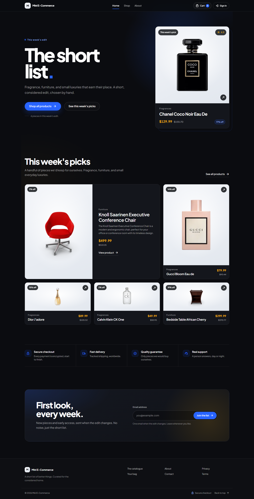
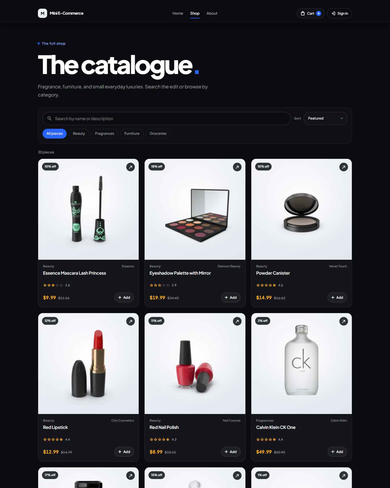
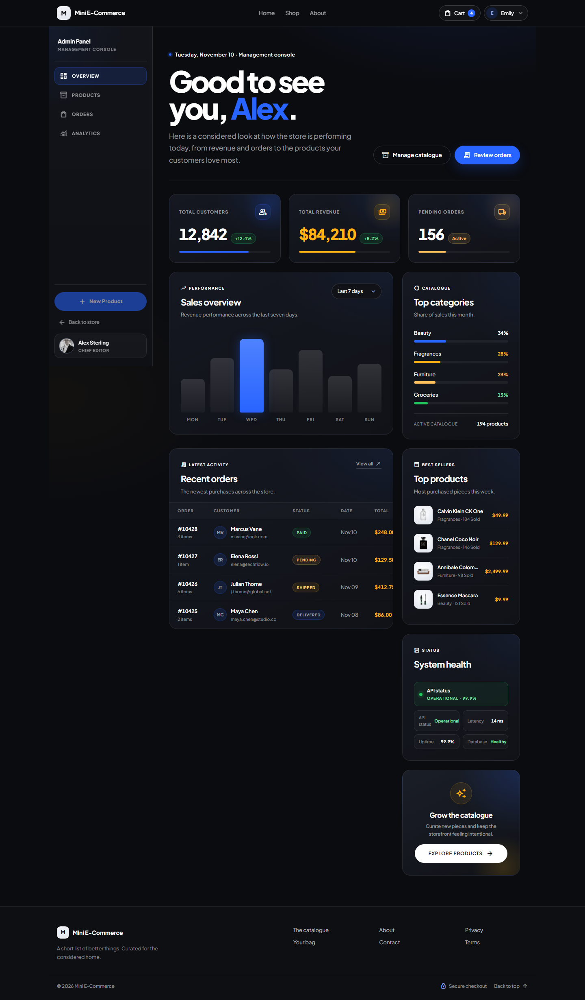

# Mini E-Commerce

A frontend-first e-commerce portfolio project: browse a curated catalogue, build a cart, sign in, complete a three-step checkout, and review your orders — plus an admin dashboard and a full set of informational pages.

**Status:** frontend complete · backend planned · demo data only

<table>
  <tr>
    <td width="34%"></td>
    <td width="33%"></td>
    <td width="33%"></td>
  </tr>
  <tr>
    <td align="center"><sub>Home — the weekly edit</sub></td>
    <td align="center"><sub>Catalogue — search, filter, sort</sub></td>
    <td align="center"><sub>Admin — management console</sub></td>
  </tr>
</table>

---

## Contents

- [The problem this project solves](#the-problem-this-project-solves)
- [At a glance](#at-a-glance)
- [Run it locally](#run-it-locally)
- [Demo accounts](#demo-accounts)
- [Five-minute walkthrough](#five-minute-walkthrough)
- [Test data for checkout](#test-data-for-checkout)
- [Features](#features)
- [Screens and routes](#screens-and-routes)
- [Tech stack](#tech-stack)
- [Architecture](#architecture)
- [What is real and what is simulated](#what-is-real-and-what-is-simulated)
- [Data stored in the browser](#data-stored-in-the-browser)
- [Known limitations](#known-limitations)
- [Backend roadmap](#backend-roadmap)
- [Screenshots](#screenshots)
- [Credits](#credits)

---

## The problem this project solves

Most e-commerce portfolio projects stop at a product grid. The hard part of a storefront is everything around it:

- sessions that survive a page refresh,
- routes that cannot be opened without signing in,
- a multi-step checkout that does not lose the user's input,
- an order model that stays consistent between confirmation, history and detail,
- and the loading, empty and error states that nobody screenshots.

This project is built around the **entire purchase journey** instead of a single page. It is deliberately frontend-first: DummyJSON supplies products, users and JWT authentication, while the cart, checkout draft and orders are persisted in `localStorage`. That keeps the UX and the future API contract honest before the FastAPI/PostgreSQL backend is built.

What a reviewer can verify in a few minutes:

- the full journey: catalogue → product → cart → checkout → confirmation → order history → order detail;
- protected routes, session restore and token refresh;
- form validation and state persistence across checkout steps;
- responsive layouts at **390 px** and **1440 px**;
- an admin dashboard, a design system and four informational pages.

> This is a portfolio/demo application. It does not process real payments, send real emails, or store data on a server. Please use the provided demo accounts and fake checkout data.

---

## At a glance

| Metric | Value |
|---|---|
| Routed pages | **16** |
| Feature modules | **9** (admin, auth, cart, checkout, layout, orders, products, profile, sign-up) |
| React context providers | **3** (auth, cart, checkout) |
| Checkout | **3 steps** — shipping → payment → review |
| Payment methods | **3** — card, crypto, bank transfer |
| Catalogue | **30 of 194** DummyJSON products loaded per request |
| Order statuses | Pending, Processed, Delivered, Cancelled |
| Verified widths | **390 px** and **1440 px** |
| Backend | FastAPI + PostgreSQL planned; folders scaffolded, no server code yet |

---

## Run it locally

### Requirements

- **Node.js 20.19+ or 22.12+** (required by Vite 7)
- npm
- An internet connection — the app calls `https://dummyjson.com` and loads product images and Google Fonts from the network

### Commands

```bash
cd frontend
npm install
npm run dev
```

Open the URL printed in the terminal — usually **http://localhost:5173**. If that port is busy, Vite picks the next free one (for example, `5174`).

> The repository root has no `package.json`. All frontend commands must be run from the `frontend/` folder.

### Other scripts

```bash
npm run build     # type-check with tsc -b, then build with Vite
npm run preview   # serve the production build locally
npm run lint      # run ESLint
```

The production bundle is written to `frontend/dist/`.

### Configuration

There is no `.env` file. The API base URL is hard-coded in [`frontend/src/services/apiClient.ts`](frontend/src/services/apiClient.ts):

```ts
baseURL: "https://dummyjson.com"
```

---

## Demo accounts

Authentication uses the real DummyJSON auth API. The accounts below were checked against DummyJSON's user list and work on the login page, profile page and the complete checkout flow.

| Username | Password | DummyJSON role | Suggested use |
|---|---|---|---|
| `emilys` | `emilyspass` | admin | Primary demo account |
| `michaelw` | `michaelwpass` | admin | Second account, to show that orders are per user |
| `sophiab` | `sophiabpass` | admin | Alternative |
| `oliviaw` | `oliviawpass` | moderator | Alternative |
| `averyp` | `averyppass` | user | Regular-customer demo |
| `johnd` | `johndpass` | user | Regular-customer demo |

DummyJSON currently exposes **208 users**, and every demo password follows the same rule:

```
password = username + "pass"
```

Examples: `jamesd` → `jamesdpass`, `avat` → `avatpass`, `gracep` → `graceppass`.

You can browse the full list at [dummyjson.com/users](https://dummyjson.com/users). If one of the accounts above stops working, the third-party demo data has probably changed.

### Two important notes

1. **Roles are not enforced.** The app reads the `role` field but has no authorization layer. Any signed-in account can open `/admin`. Role-based access is part of the backend roadmap.
2. **Sign-up is a demo of the flow, not a working registration.** The form validates the input and calls DummyJSON's `POST /users/add`, but that endpoint does not create credentials that can sign in. Use the accounts above.

---

## Five-minute walkthrough

1. **Home** — land on `/`. The hero and the five featured pieces are a hand-picked edit fetched from DummyJSON.
2. **Catalogue** — click **Shop**. Try a search such as `mascara`, switch category pills, then change the sort order. The results count updates live.
3. **Product detail** — open any product. Check the discount badge, original price, stock state, assurances, specifications and reviews.
4. **Cart** — press **Add to cart** (or **Buy now**, which adds the item and opens the cart). The navbar badge updates immediately. Change quantities and remove an item.
5. **Checkout entry** — press **Proceed to checkout**.
   - Signed out: you are sent to `/login`. Sign in with `emilys` / `emilyspass`.
   - After login the app currently opens **`/profile`**, not the checkout. Return to **Cart** and press **Proceed to checkout** again.
   - Signed in: the checkout opens directly.
6. **Shipping** — fill the form. The ZIP code must be exactly **5 digits**.
7. **Payment** — choose Card, Crypto or Bank transfer and use the test values below.
8. **Review** — confirm the order. The fake gateway waits about **1.5 seconds**. It intentionally rejects roughly **20% of attempts** to exercise the error state. If that happens, press **Try again**.
9. **Confirmation** — on success the cart and checkout draft are cleared, an order is saved to your account, and `/checkout/success` shows the most recent order.
10. **Orders** — open **View my orders**. The list supports status filters and statistics; click any order to see items, shipping address and totals.
11. **Profile and admin** — `/profile` shows the account details returned by `/auth/me` and the three most recent orders. `/admin` opens the management dashboard.
12. **Order isolation** — log out, sign in as `michaelw`, and open **Orders**. The orders created as `emilys` are not visible: orders are keyed by DummyJSON user ID.

---

## Test data for checkout

These values satisfy the client-side validation. Nothing is charged and nothing leaves the browser.

### Shipping

| Field | Value |
|---|---|
| Full name | `John Doe` |
| Street address | `123 Main St` |
| City | `New York` |
| ZIP code | `10001` (exactly 5 digits) |
| Country | `United States` |

### Card

| Field | Value |
|---|---|
| Card number | `4242 4242 4242 4242` (exactly 16 digits) |
| Card holder | `John Doe` (letters and spaces only) |
| Expiry month | `12` |
| Expiry year | `2030` (current year or later) |

### Crypto

| Field | Value |
|---|---|
| Wallet address | `1A1zP1eP5QGefi2DMPTfTL5SLmv7DivfNa` (26–42 alphanumeric characters) |
| Network | `Bitcoin` |

### Bank transfer

| Field | Value |
|---|---|
| Bank name | `Example Bank` (letters and spaces only) |
| Account number | `12345678901234567890` (exactly 20 digits) |
| Account holder | `John Doe` (letters and spaces only) |

---

## Features

### Storefront

- **Home** — editorial hero, hand-picked featured products, trust strip and a newsletter form (feedback only, no mailing list).
- **Catalogue** — search over product titles and descriptions, category pills, four sort modes (featured, price ascending, price descending, top rated), live result counts, clear-filters action, skeleton loading, and dedicated empty/error states with retry.
- **Product detail** — image plate, discount badge, original price, rating stars, stock status (including low-stock and sold-out states), shipping/checkout/stock assurances, specifications, and reviews from the API.
- **Cart** — persisted line items, quantity steppers (minimum 1), remove actions, line totals, subtotal, 8% tax and free shipping. Empty-cart state included.
- **Buy now** — adds the product and navigates straight to the cart.

### Checkout and orders

- **Three-step checkout** — shipping → payment → review, with a visual progress stepper and the ability to jump back and edit any step.
- **Validation** — inline field errors and touched-state handling for shipping and all three payment methods.
- **Draft persistence** — shipping and payment data are saved to `localStorage`, so refreshing or stepping back does not wipe the form.
- **Checkout guards** — the route requires authentication, and an empty cart redirects to `/products`.
- **Simulated gateway** — 1.5-second delay and a deliberate ~20% failure rate, a loading state, an error state with retry, and toast feedback.
- **Order creation** — on success the order is saved per user, the cart is cleared and the checkout draft is reset.
- **Order history** — newest first, statistics for each status, status filters, clickable cards, and a detail page with items, shipping information, totals and a support link. New orders start as **Processed**.

### Account and session

- **Login** — DummyJSON JWT authentication with a 30-minute access token and refresh token.
- **Session restore** — on reload, the stored token is validated against `/auth/me` instead of trusting `localStorage`.
- **Refresh queue** — a single-flight refresh lock, a queue for requests that received parallel `401`s, one retry per request and a loop guard.
- **Route guards** — protected routes show a "Restoring session…" loader while the session is checked, then either render or redirect to login. Login and sign-up are guest-only and redirect authenticated users away.
- **Profile** — identity details, location, recent three orders, security/preferences panels, section navigation and logout.
- **Sign-up** — client-side validation and the complete request lifecycle (see the caveat above).

### Admin dashboard

- KPI cards, weekly sales bar chart, category share, recent orders table, top products and a system-health panel.
- One shared storefront navbar with a sticky sidebar, plus an off-canvas mobile menu.
- Quick links to the catalogue and order history, and an analytics anchor.
- **All admin data is mock data**, and most management actions are placeholders.

### Content and cross-cutting UX

- **About**, **Contact**, **Privacy** (with a scroll-spy table of contents) and **Terms** pages that share the storefront's visual language.
- Toasts, skeleton loaders, empty states, error states with retry, and live result/status announcements.
- Responsive from **1440 px** down to **390 px**, with mobile navigation and an off-canvas admin sidebar.
- Accessibility work: skip link, semantic landmarks, labeled controls, `aria-live` status regions, visible focus styles and reduced-motion support.
- Hand-written CSS with design tokens — no component kit or utility framework.

---

## Screens and routes

| # | Page | Route | Access | Preview |
|---|---|---|---|---|
| 01 | Home | `/` | Public | [Desktop](screenshots/desktop/01-home.png) · [Mobile](screenshots/mobile/01-home.png) |
| 02 | Catalogue | `/products` | Public | [Desktop](screenshots/desktop/02-products.png) · [Mobile](screenshots/mobile/02-products.png) |
| 03 | Product detail | `/products/:id` | Public | [Desktop](screenshots/desktop/03-product-detail.png) · [Mobile](screenshots/mobile/03-product-detail.png) |
| 04 | Cart | `/cart` | Public | [Desktop](screenshots/desktop/04-cart.png) · [Mobile](screenshots/mobile/04-cart.png) |
| 05 | Checkout | `/checkout` | Auth + non-empty cart | [Desktop](screenshots/desktop/05-checkout.png) · [Mobile](screenshots/mobile/05-checkout.png) |
| 06 | Order confirmation | `/checkout/success` | Auth only | [Desktop](screenshots/desktop/06-order-success.png) · [Mobile](screenshots/mobile/06-order-success.png) |
| 07 | Profile | `/profile` | Auth only | [Desktop](screenshots/desktop/07-profile.png) · [Mobile](screenshots/mobile/07-profile.png) |
| 08 | Orders | `/profile/orders` | Auth only | [Desktop](screenshots/desktop/08-orders.png) · [Mobile](screenshots/mobile/08-orders.png) |
| 09 | Order detail | `/profile/orders/:id` | Auth only | [Desktop](screenshots/desktop/09-order-detail.png) · [Mobile](screenshots/mobile/09-order-detail.png) |
| 10 | Login | `/login` | Guest only | [Desktop](screenshots/desktop/10-login.png) · [Mobile](screenshots/mobile/10-login.png) |
| 11 | Sign up | `/signup` | Guest only | [Desktop](screenshots/desktop/11-signup.png) · [Mobile](screenshots/mobile/11-signup.png) |
| 12 | About | `/about` | Public | [Desktop](screenshots/desktop/12-about.png) · [Mobile](screenshots/mobile/12-about.png) |
| 13 | Contact | `/contact` | Public | [Desktop](screenshots/desktop/13-contact.png) · [Mobile](screenshots/mobile/13-contact.png) |
| 14 | Privacy | `/privacy` | Public | [Desktop](screenshots/desktop/14-privacy.png) · [Mobile](screenshots/mobile/14-privacy.png) |
| 15 | Terms | `/terms` | Public | [Desktop](screenshots/desktop/15-terms.png) · [Mobile](screenshots/mobile/15-terms.png) |
| 16 | Admin | `/admin` | Auth only — no role check | [Desktop](screenshots/desktop/16-admin.png) · [Mobile](screenshots/mobile/16-admin.png) |

The route table lives in [`frontend/routes.tsx`](frontend/routes.tsx). `/admin` renders a nested layout with its own dashboard child route.

---

## Tech stack

| Layer | Choice |
|---|---|
| UI | React 19.2 |
| Language | TypeScript 5.9 (strict project references) |
| Build tool | Vite 7 (`rolldown-vite` 7.2.5) |
| Routing | React Router 7.13 |
| HTTP | Axios 1.21 with request/response interceptors |
| State | React Context API + custom hooks |
| Feedback | `react-hot-toast` |
| Styling | Hand-written CSS, design tokens, Plus Jakarta Sans, Material Symbols |
| API | DummyJSON — products, users and auth |
| Persistence | `localStorage` (session, cart, checkout draft, orders) |

---

## Architecture

The frontend uses a **feature-based structure**. Each feature owns its components, pages, hooks, services, context, types and utilities, which keeps cross-feature imports rare and makes the planned backend easy to slot in.

```text
mini-ecommerce/
├─ frontend/
│  ├─ routes.tsx                  # all 16 routes and route guards
│  ├─ package.json
│  └─ src/
│     ├─ main.tsx                 # providers + router bootstrap
│     ├─ services/
│     │  └─ apiClient.ts          # Axios instance, token injection, refresh queue
│     ├─ assets/styles/global.css # design tokens and global styles
│     └─ features/
│        ├─ admin/                # dashboard, layout, sidebar, mock data
│        ├─ auth/                 # context, guards, login, storage, services
│        ├─ cart/                 # context, cart page, items, summary
│        ├─ checkout/             # steps, forms, guards, draft state, fake API
│        ├─ layout/               # navbar, footer, home, about, contact, legal
│        ├─ orders/               # storage, list, detail, statuses
│        ├─ products/             # catalogue, detail, API, types
│        ├─ profile/              # identity, orders, preferences
│        └─ sign-up/              # form, validation, users storage
├─ backend/
│  ├─ app/modules/                # auth, users, products, carts, orders (empty)
│  ├─ app/shared/                 # reserved
│  ├─ app/tests/                  # reserved
│  └─ alembic/                    # reserved
├─ screenshots/
│  ├─ desktop/                    # 16 full-page screenshots at 1440 px
│  └─ mobile/                     # 16 screenshots at 390 px @2x
└─ README.md
```

### Request and session lifecycle

1. `AuthProvider` mounts and calls `restoreSession()`.
2. If a stored `auth_session` exists, the access token is injected into Axios and the user is validated with `GET /auth/me`.
3. `apiClient` adds `Authorization: Bearer <accessToken>` to every request.
4. On a `401`, the response interceptor starts **one** refresh request. Parallel failures wait in a queue, then retry with the new token.
5. If refresh fails, or a retried request is rejected again, the session is removed.
6. `ProtectedRoute` waits for the check to finish before rendering or redirecting, preventing the login-page flicker.

### Providers

`main.tsx` wraps the router in this order:

```text
AuthProvider → CartProvider → CheckoutProvider → RouterProvider
```

`CheckoutGuard` reads the cart length, so it must sit inside `CartProvider`. The auth guard reads `AuthProvider`, so it must sit inside `AuthProvider`.

---

## What is real and what is simulated

Being explicit here makes the project easier to review and harder to misrepresent.

| Capability | Status | Details |
|---|---|---|
| Product catalogue | **Real API** | `GET https://dummyjson.com/products` |
| Product detail and reviews | **Real API** | `GET /products/:id` |
| Login and token refresh | **Real API** | DummyJSON JWT access/refresh tokens |
| Session restore | **Real** | Validated with `GET /auth/me` on load |
| Sign-up | **Simulated** | `POST /users/add`; the new account cannot log in |
| Cart | **Client-side** | Persisted in `localStorage` |
| Checkout draft | **Client-side** | Shipping and payment persisted locally |
| Payment | **Simulated** | 1.5 s delay, ~20% random failure, no charge |
| Orders | **Client-side** | Stored per DummyJSON user ID |
| Admin data | **Mock** | Hard-coded metrics, chart, orders and products |
| Contact form | **Simulated** | Shows success feedback; sends nothing |
| Newsletter form | **Simulated** | Shows success feedback; sends nothing |
| Profile preferences | **UI only** | Toggles render but do not persist |
| Profile edit/delete | **UI only** | Buttons are placeholders |
| Backend | **Not implemented** | Folder scaffold only |

---

## Data stored in the browser

| `localStorage` key | Written by | Contents |
|---|---|---|
| `auth_session` | Auth feature | User object plus access and refresh tokens |
| `cart` | Cart feature | Product snapshots and quantities |
| `checkout` | Checkout feature | Current step, shipping data and payment data |
| `user_orders` | Orders feature | Map of user ID → array of orders |
| `registered_users` | Sign-up feature | Accounts created through the demo sign-up form |

Clearing site data resets the demo completely. Two consequences worth knowing:

- the **cart is shared by every account in the same browser** — it is not scoped to the signed-in user;
- **orders are scoped by user ID**, so switching accounts changes the visible order history.

---

## Known limitations

These are deliberate scope boundaries or known gaps, not hidden surprises.

1. **Only 30 of 194 products are loaded.** `GET /products` uses DummyJSON's default limit of 30. There is no pagination or infinite scroll yet, so search, categories and sorting operate on those 30 items.
2. **Sign-up cannot create a usable login.** DummyJSON's add-user endpoint does not persist credentials for the auth API.
3. **`/admin` has authentication but no authorization.** There is no `admin` role check; any signed-in user can open it. The dashboard also shows a mock admin identity, not the signed-in user.
4. **Payments are simulated and fail randomly.** Roughly one in five attempts returns a failure on purpose. Use **Try again**; the cart is untouched.
5. **No server persistence.** Cart, checkout draft and orders live in one browser. They do not sync across devices, and clearing storage deletes them.
6. **Login does not resume the original destination.** Signing in always redirects to `/profile`, even when the user was sent to login from the cart or checkout.
7. **Admin actions are placeholders.** "New Product" is disabled, "Manage catalogue" opens the storefront, and "Analytics" scrolls to the sales panel. There is no CRUD.
8. **Admin mock statuses do not match customer order statuses.** The dashboard uses Paid/Pending/Shipped/Delivered; customer orders use Pending/Processed/Delivered/Cancelled.
9. **Profile preferences and danger-zone actions are inert.** The toggles and "Delete Account" button are visual only.
10. **Reviews are read-only.** There is no review submission flow.
11. **No automated tests or CI.** The build is type-checked, but there are no unit, integration or E2E suites yet. The production build also warns about a JavaScript chunk larger than 500 kB because there is no route-level code splitting.
12. **Network dependency.** Product images, fonts and API data come from external services, so the app needs an internet connection and is affected by third-party downtime.
13. **Legal and editorial copy is fictional.** Privacy, Terms and About text exist to demonstrate layout and are not legal advice.

---

## Backend roadmap

The `backend/` folder already contains the intended module boundaries — `auth`, `users`, `products`, `carts`, `orders` — plus `shared`, `tests` and `alembic`. There is no Python code yet.

| Phase | Goal |
|---|---|
| 1. Backend foundation | FastAPI app, PostgreSQL, SQLAlchemy models, Alembic migrations, JWT auth with password hashing and refresh-token rotation |
| 2. Replace local state | Move users, carts, orders and checkout to the database; make checkout transactional; reserve inventory |
| 3. Commerce features | Stripe payments, order emails, real order statuses, review submission, wishlist, coupons, server-side search/filter/pagination |
| 4. Admin | Product/order/customer CRUD, role-based access, analytics derived from real data |
| 5. Quality and delivery | Vitest + Testing Library + Playwright, CI pipeline, Docker Compose, deployment, route-level code splitting, accessibility audit, i18n/currency |

The frontend already models the API contract: typed product, auth, cart, checkout and order shapes, a shared Axios client, and storage services that can be swapped for HTTP services without rewriting the pages.

---

## Screenshots

- `screenshots/desktop/` — 16 full-page captures at **1440 px** wide.
- `screenshots/mobile/` — 16 captures at **390 px** wide with **2×** pixel density.

The catalogue screenshot is intentionally capped at 1800 px tall because the product grid is long; the other pages are captured full-length. Privacy and Terms are supporting pages and are better used in a portfolio archive than in a social-media carousel.

---

## Credits

- Product, user and auth data: [DummyJSON](https://dummyjson.com)
- Product images: DummyJSON CDN
- Icons: Material Symbols (Google Fonts)
- Typeface: Plus Jakarta Sans (Google Fonts)
- Admin avatar photography: Unsplash

This is a portfolio and educational project. Product data and third-party assets belong to their respective owners. No license is declared for the application code.
